# Olist Delivery Impact

**Recensioni negative: consegna o prodotto?**

App online: [Consegne e recensioni Olist](https://gr1gorii-olist-delivery.streamlit.app/)

[English](README.md) | **Italiano**

Ho analizzato 99.441 ordini Olist per capire dove destinare il budget: processi di consegna, completezza degli ordini o qualità dei prodotti.

**Problema e metrica di business.** Gli ordini consegnati hanno una media di **4,16/5**; il 6,8% arriva in ritardo. Gli ordini in ritardo ricevono **2,27 stelle**, contro **4,29** per quelli puntuali. Tuttavia, **il 67,6% delle recensioni da una o due stelle riguarda ordini puntuali**. La consegna da sola non spiega i voti negativi.

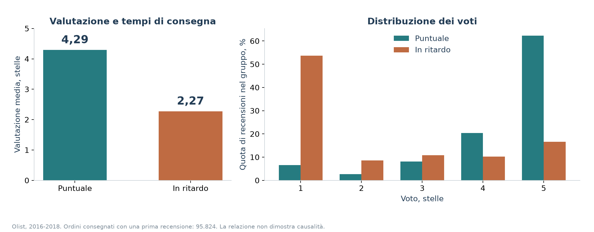

> **Tre risultati**
>
> 1. **Penalità del ritardo:** -0,50 stelle alla soglia di ritardo, più -0,30/giorno nei giorni 1-7. Sono associazioni osservazionali con effetti fissi del venditore.
> 2. **Tempi del questionario:** l’81,6% di tutti gli ordini in ritardo ha un questionario creato prima della consegna. È la data dell’invito; il 68,5% ha una risposta scritta prima della consegna.
> 3. **Riacquisti:** circa l’1,0% degli acquirenti riacquista entro 90 giorni. Non trovo un ritorno dimostrato dalla consegna più rapida tramite i riacquisti. Con beneficio di riacquisto zero, il budget base di pareggio è R$0,12/ordine.

**Raccomandazione.** Inviterei alla recensione dopo la consegna confermata, manterrei un canale di reclamo separato per gli ordini non consegnati e userei il ranking con lift 2,59x per inviare notifiche preventive al decile a rischio più alto. Validerei entrambe le politiche in un test A/B per acquirente, con voto primario e reclami/cancellazioni secondari. [Disegno del test](#raccomandazione-e-test-ab).

## Demo e riproduzione

La demo Streamlit ha cinque schede in inglese e italiano: grafici filtrabili, reclami con testo, venditori e stati, modulo di rischio al checkout e calcolatore delle ipotesi. L’archivio locale include risultati preparati; dopo aver installato le dipendenze posso avviarlo con `streamlit run app.py`.

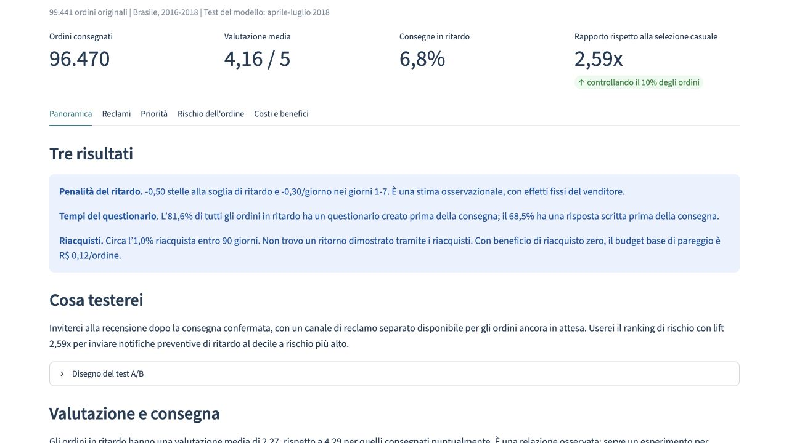

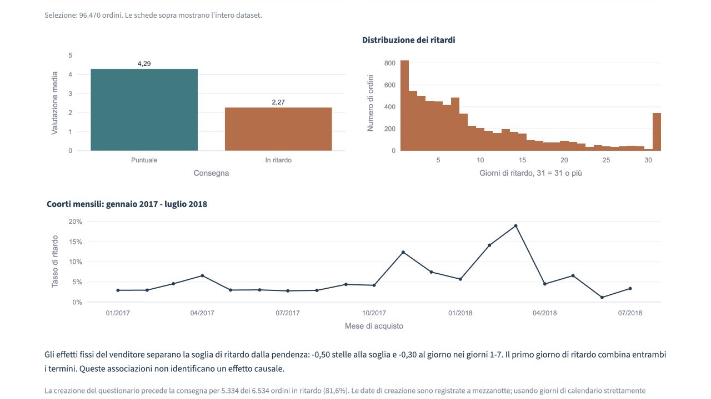

```bash
git clone https://github.com/Gr1gorii/olist-delivery-impact.git
cd olist-delivery-impact
python3.11 -m venv .venv
source .venv/bin/activate
pip install -r requirements.txt
python scripts/download_data.py
python scripts/run_analysis.py --topics
python scripts/analyze_survey_timing.py
python scripts/make_figures.py
python -m pytest -q
streamlit run app.py
```

Ho verificato Python 3.11. Lo script scarica da Kaggle le sei tabelle CSV originali e verifica il manifest SHA-256. Non salvo credenziali. `--language it` seleziona i messaggi italiani. Senza `--topics` ricalcolo tutte le altre analisi e conservo i temi esistenti. La revisione dell’encoder è fissata e i vettori sono salvati in cache. Un checkout Git pulito scarica l’encoder al primo avvio dei temi. `OMP_NUM_THREADS=4 OPENBLAS_NUM_THREADS=4` limita i thread dove necessario; `--server.port 8503` cambia la porta della demo.

## Risultati dell’audit e correzioni

Ho riportato i problemi prima di modificare il progetto. Non ho trovato esiti di consegna o recensione direttamente tra le variabili di rischio. Gli storici originali aspettavano la consegna, ma mancava lo storico di categoria e le ipotesi sul checkout erano documentate solo in parte. Ho aggiunto lo storico di categoria, test dei confini e una nuova valutazione temporale. Ho misurato i riacquisti con `customer_unique_id`: il precedente aumento ipotizzato non era un tasso osservato. Ora il suo valore base è zero.

Ho separato creazione del questionario e risposta, aggiunto veri effetti fissi del venditore e confronti grezzi, misurato il testo mancante e chiarito gli ordini con più venditori. Gli errori standard raggruppati per venditore del modello precedente non equivalevano a effetti fissi. Ho corretto anche lo scenario affinché azzeri sia l’indicatore di ritardo sia i giorni di ritardo; i test verificano il controfattuale completo. Dati grezzi e binari sono esclusi da Git e ho aggiunto l’attribuzione bilingue della licenza.

## Dati, ritardo e attribuzione

Fonte: [Brazilian E-Commerce Public Dataset by Olist](https://www.kaggle.com/datasets/olistbr/brazilian-ecommerce), 2016-2018, [CC BY-NC-SA 4.0](https://creativecommons.org/licenses/by-nc-sa/4.0/). Dettagli di attribuzione e trasformazioni: [DATA_LICENSE.it.md](DATA_LICENSE.it.md).

| Popolazione | Ordini |
| --- | ---: |
| Fonte | 99.441 |
| Consegnati con date e articoli validi | 96.470 |
| Con prima recensione e voto | 95.824 |
| Consegnati in ritardo | 6.534 |
| Consegnati con più venditori | 1.275 |

Mantengo una riga e una prima recensione per ordine. Scelgo la prima risposta per timestamp, poi l’ID recensione in caso di parità. La fonte ha 551 righe di recensione aggiuntive. Definisco:

```text
delay_days = date(order_delivered_customer_date) - date(order_estimated_delivery_date)
late = delay_days > 0
```

Una consegna alle 23:59 del giorno promesso è puntuale. Escludo cancellazioni, ordini non consegnati, date non valide e articoli mancanti. Il rischio è condizionato alla consegna finale; i limiti temporali escludono anche consegne ancora irrisolte.

Un ordine con più venditori ha una recensione condivisa; non la duplico per venditore. Il venditore principale per il checkout è quello con il valore totale della merce maggiore, poi l’ID come criterio di parità. La categoria viene dall’articolo più costoso, poi dall’ID prodotto. Ranking dei venditori e regressioni con effetti fissi usano **solo ordini con un venditore**. Gli ordini con più venditori restano nelle analisi per stato e ordine, ricevono incremento del voto modellato pari a zero e sostengono il costo se selezionati tramite lo stato. Il venditore principale è una convenzione per le variabili, non un’attribuzione di colpa.

Conservo testi e codici di categoria portoghesi. Mostro etichette tradotte e gli stessi 50 esempi verificati nelle due lingue; le traduzioni non entrano nel clustering.

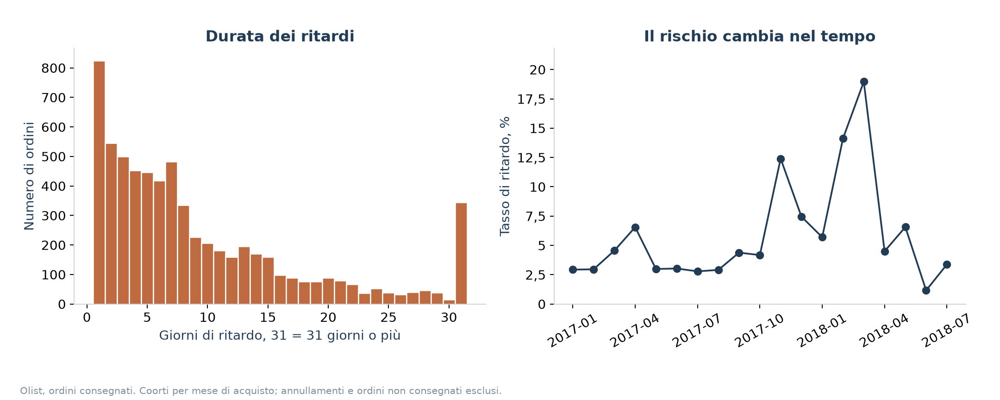

## Tempi del questionario e impatto sul voto

`review_creation_date` è la data di creazione dell’invito al questionario; `review_answer_timestamp` è la risposta. La [descrizione del dataset](https://www.kaggle.com/datasets/olistbr/brazilian-ecommerce) indica che gli inviti seguono la consegna o la data prevista. Un invito prima della consegna è quindi atteso per molti ordini in ritardo.

| Prima della consegna effettiva | Numeratore | Denominatore | Quota |
| --- | ---: | ---: | ---: |
| Timestamp di creazione, tutti gli ordini in ritardo | 5.334 | 6.534 | 81,6% |
| Timestamp di creazione, ordini in ritardo con voto | 5.334 | 6.381 | 83,6% |
| Creazione in un giorno strettamente precedente, tutti i ritardi | 4.753 | 6.534 | 72,7% |
| Timestamp della risposta, tutti i ritardi | 4.476 | 6.534 | 68,5% |

Le creazioni sono registrate a mezzanotte; 581 inviti nello stesso giorno spiegano la differenza tra timestamp e calendario. I tempi mancanti restano nel denominatore di tutti i ritardi e sono riportati in [review_timing.csv](reports/review_timing.csv). Uso la divisione per timestamp richiesta e ne mostro la sensibilità alla risoluzione giornaliera.

Stimo OLS con **effetti fissi del venditore**, stato del cliente, categoria, mese, `log(1 + prezzo)`, `log(1 + trasporto)`, durata promessa e numero di articoli. Assorbo le variabili indicatrici del venditore con [AbsorbingLS](https://bashtage.github.io/linearmodels/iv/absorbing/linearmodels.iv.absorbing.AbsorbingLS.html) e raggruppo gli intervalli al 95% per venditore. Acquisti, consegne e risposte del campione precedono il 1 aprile 2018; escludo ordini con più venditori. Le differenze grezze usano lo stesso campione di ciascun modello.

| Campione | Recensioni | Ritardo - puntualità grezzo | Soglia di ritardo | Giorni 1-7, al giorno | Primo giorno di ritardo |
| --- | ---: | ---: | ---: | ---: | ---: |
| Tutte le recensioni ammissibili | 58.743 | -2,03 | -0,50 | -0,30 | -0,80 |
| Questionario creato prima della consegna | 4.311 | -2,27 | -1,09 | -0,20 | -1,29 |
| Questionario creato dopo/alla consegna | 54.432 | -0,53 | -0,70 | 0,14 | -0,56 |
| Risposta dopo/alla consegna | 56.065 | -0,61 | -0,55 | 0,01 | -0,54 |

La differenza grezza complessiva è **-2,03 stelle**. Il primo giorno di ritardo aggiustato vale **-0,80**, con intervallo al 95% **[-0,91; -0,69]**. Combina la soglia **-0,50** (intervallo [-0,64; -0,37]) e la pendenza della prima settimana **-0,30/giorno** ([-0,32; -0,27]). Il salto tra puntualità e ritardo non equivale all’associazione per giorno.

```text
Componente del voto legata al ritardo = soglia × late
  + pendenza_1 × min(max(delay_days, 0), 7)
  + pendenza_2 × min(max(delay_days - 7, 0), 7)
  + pendenza_3 × min(max(delay_days - 14, 0), 16)
```

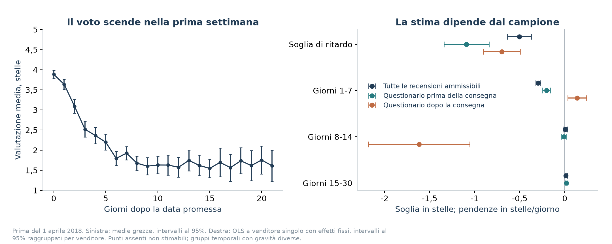

La pendenza della prima settimana è +0,14/giorno nel gruppo con creazione dopo la consegna e +0,01/giorno per le risposte successive alla consegna, con intervallo che include zero. Sono gruppi selezionati, non prove che i ritardi migliorino i voti. Gli ordini in ritardo con voto hanno 12,26 giorni medi nel gruppo di creazione precedente e 1,64 nel gruppo successivo. Il momento del questionario dipende dalla gravità finale del ritardo. Nel gruppo di creazione successiva il termine giorni 15-30 non è stimabile: lo salvo come mancante e assegno incremento zero agli ordini non supportati nello scenario. Non estrapolo oltre il limite di 30 giorni. Gli effetti fissi eliminano differenze stabili dei venditori, ma non ogni confondente né dimostrano causalità.

Stime complete: [complessiva](reports/rating_coefficients.csv), [creazione prima](reports/rating_before_delivery.csv), [creazione dopo](reports/rating_after_delivery.csv), [risposta dopo](reports/rating_after_response.csv), [confronti grezzi omogenei](reports/rating_comparison.csv).

## La penalità «non ancora ricevuto»

Confronto gli ordini in ritardo con questionario creato prima della consegna con quelli creati dopo o alla consegna, **allo stesso giorno esatto di ritardo e con effetti fissi del venditore**. È un’analisi osservazionale separata; mantengo invariati i modelli esistenti di rischio e voto. Uso acquisti, consegne e risposte noti prima del 1 aprile 2018 e solo ordini a venditore singolo.

Il confronto contiene **1.966 ordini di 631 venditori**: 1.382 con creazione prima della consegna e 584 dopo o alla consegna. Entrambi i gruppi sono presenti a ritardi di **1-6 o 8 giorni**. Escludo 1.507 ordini senza sovrapposizione del giorno di ritardo. I voti finali medi sono **2,20 contro 3,76**, con differenza grezza **-1,56 stelle**. Dopo aver assorbito effetti del venditore e del giorno esatto, la differenza per creazione precedente è **-1,06 stelle**, con intervallo al 95% raggruppato per venditore **[-1,31; -0,82]**.

```text
review_score = effetto venditore + effetto del giorno esatto + beta × before_delivery + residuo
```

| Confronto | Ordini | Venditori | Prima - dopo, stelle | Intervallo al 95% |
| --- | ---: | ---: | ---: | --- |
| Creazione, timestamp | 1.966 | 631 | -1,06 | [-1,31; -0,82] |
| Creazione, sensibilità per giorno | 2.246 | 677 | -1,16 | [-1,45; -0,87] |
| Creazione, stesso venditore e giorno di ritardo | 413 | 69 | -0,93 | [-1,24; -0,62] |
| Risposta scritta, timestamp | 2.928 | 775 | -1,96 | [-2,14; -1,78] |

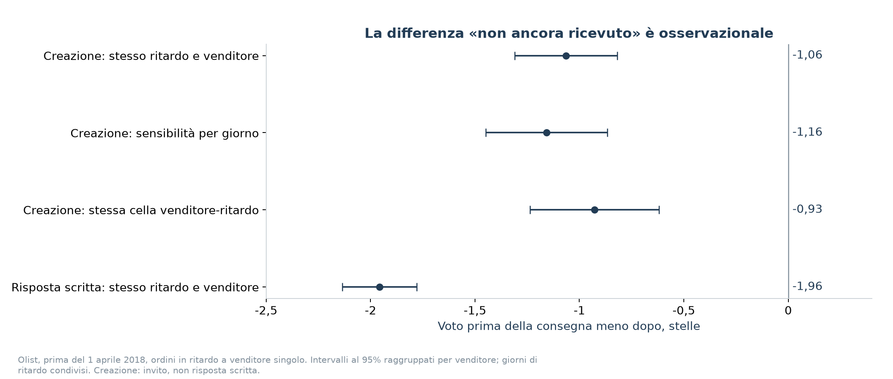

Il confronto più rigoroso per venditore e giorno di ritardo usa 413 ordini di 69 venditori e dà **-0,93 stelle**. Il confronto delle risposte scritte dà **-1,96 stelle** nel proprio campione sovrapposto e misura il momento della risposta, non dell’invito. La creazione a mezzanotte non dimostra che il cliente non avesse ricevuto il pacco quando scriveva. Queste stime non isolano l’effetto di un invito successivo, non si estendono a ritardi senza sovrapposizione e non si possono sommare ai coefficienti esistenti o al calcolo del profitto.

[Tabella completa](reports/not_received_penalty.csv). La rigenero con `python scripts/analyze_survey_timing.py`, che non riaddestra né sovrascrive i modelli esistenti.

## Raccomandazione e test A/B

Inviterei alla recensione **solo dopo la consegna confermata**, mantenendo un canale di reclamo separato per gli ordini non ancora consegnati. Userei il ranking esistente con **lift 2,59x** per inviare notifiche preventive di ritardo al **decile a rischio più alto**, con una soglia congelata su una coorte precedente. Le notifiche spiegherebbero il ritardo atteso e il prossimo aggiornamento. Queste modifiche affrontano attesa e comunicazione; il modello non dimostra che una notifica migliori i voti.

Validerei entrambe le politiche con un **test randomizzato 2 × 2**:

| Tempi del questionario | Comunicazione | Gruppo |
| --- | --- | --- |
| Processo attuale | Aggiornamenti abituali | Controllo |
| Dopo consegna confermata | Aggiornamenti abituali | Tempi del questionario |
| Processo attuale | Notifiche preventive nel decile a rischio più alto | Notifiche |
| Dopo consegna confermata | Notifiche preventive nel decile a rischio più alto | Entrambi |

**Unità di randomizzazione.** Assegnerei `customer_unique_id` al checkout, mantenendo l’assegnazione nei riacquisti e usando il primo ordine ammissibile come ordine indice. Stratificherei per decile di rischio al checkout e stato del cliente. Il canale di reclamo resterebbe disponibile in tutti i gruppi, così il cambio dei tempi del questionario non elimina l’accesso per chi non ha ricevuto l’ordine.

**Metrica primaria.** Confronterei il voto medio della prima recensione raccolta entro **60 giorni dalla data di consegna stimata originale**, con lo stesso orizzonte in tutti i gruppi. Stimerei i due effetti dei trattamenti assegnati e la loro interazione; riporterei anche il confronto delle notifiche nel decile preselezionato. Il voto primario è una media tra i rispondenti, quindi affiancherei copertura delle recensioni e delle consegne confermate. Una media maggiore dovuta a meno rispondenti insoddisfatti non dimostrerebbe un servizio migliore.

**Metriche secondarie.** Misurerei contatti di reclamo per 100 ordini indice randomizzati e tasso di cancellazione nello stesso orizzonte, includendo gli ordini mai consegnati. Riporterei costi delle notifiche e dell’assistenza. Manterrei le date promesse fisse, dimensionerei il test da varianza storica dei voti, tasso di risposta ed effetto minimo utile prestabilito, e fisserei limiti per reclami/cancellazioni prima dell’avvio. Analizzerei i gruppi assegnati con intervalli di confidenza e attenderei l’osservazione completa prima della decisione di estendere l’intervento.

## Copertura del testo e temi dei reclami

**55.224/95.824 recensioni con voto (57,6%) non hanno titolo o messaggio non vuoto.** La loro media è 4,41, contro 3,81 per le 40.600 recensioni con testo. I temi descrivono solo queste ultime e non l’intera popolazione delle recensioni.

| Voto | Senza testo, numero (% nel gruppo) | Con testo, numero (% nel gruppo) |
| --- | ---: | ---: |
| 1 | 2.028 (3,7%) | 7.313 (18,0%) |
| 2 | 921 (1,7%) | 2.000 (4,9%) |
| 3 | 4.389 (8,0%) | 3.514 (8,7%) |
| 4 | 12.707 (23,0%) | 6.192 (15,2%) |
| 5 | 35.179 (63,7%) | 21.581 (53,2%) |

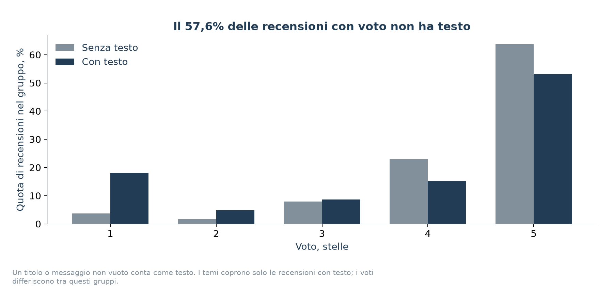

Raggruppo **9.108 recensioni da 1-2 stelle con almeno 15 caratteri**, usando vettori normalizzati di [multilingual-e5-small](https://huggingface.co/intfloat/multilingual-e5-small), prefisso `query:` e KMeans con dieci cluster. Addestro su 5.776 recensioni note prima del 1 aprile 2018 e assegno le successive ai centri salvati. I nomi derivano da parole ed esempi precedenti al test. La demo mostra cinque esempi casuali tradotti per cluster, con gli originali disponibili.

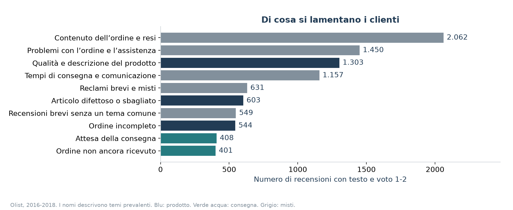

La separazione è debole (silhouette di training 0,020) e il 58,7% dei reclami con testo del test resta in gruppi misti. Nel piccolo controllo casuale, 14/15 esempi dei tre gruppi orientati al prodotto riguardano prodotti o contenuti dell’ordine; solo 6/10 nei gruppi di attesa riguardano la logistica. Questi valori non stimano l’accuratezza sull’intero corpus. Danni o articoli mancanti non identificano la fase responsabile. Tabelle: [copertura del testo](reports/text_coverage.csv), [distribuzione dei voti](reports/score_by_text.csv), [controllo dei temi](reports/topic_audit.csv).

## Tutte le variabili di rischio al checkout

| Variabile | Fonte al momento dell’acquisto | Disponibilità |
| --- | --- | --- |
| `log_price` | log(1 + valore della merce nel carrello) | Carrello/indirizzo/orario al checkout |
| `freight_share` | Trasporto preventivato / max(valore del carrello, 1) | Carrello/indirizzo/orario al checkout |
| `item_count` | Articoli nel carrello | Carrello/indirizzo/orario al checkout |
| `seller_count` | Venditori distinti nel carrello | Carrello/indirizzo/orario al checkout |
| `weight` | Somma dei pesi degli articoli da catalogo | Snapshot al checkout ipotizzato |
| `promised_days` | Data di consegna stimata meno data di acquisto, giorni di calendario | Snapshot al checkout ipotizzato |
| `purchase_month` | Mese del timestamp di acquisto | Carrello/indirizzo/orario al checkout |
| `purchase_weekday` | Giorno della settimana del timestamp di acquisto | Carrello/indirizzo/orario al checkout |
| `purchase_hour` | Ora del timestamp di acquisto | Carrello/indirizzo/orario al checkout |
| `same_state` | Stato del venditore principale uguale a quello del cliente | Snapshot al checkout ipotizzato |
| `seller_past_count` | Consegne precedenti osservabili del venditore principale | Solo acquisti e consegne precedenti |
| `seller_past_late` | Tasso di ritardo regolarizzato di queste consegne | Solo acquisti e consegne precedenti |
| `region_past_count` | Consegne precedenti osservabili nello stato del cliente | Solo acquisti e consegne precedenti |
| `region_past_late` | Tasso di ritardo regolarizzato di queste consegne | Solo acquisti e consegne precedenti |
| `category_past_count` | Consegne precedenti osservabili nella categoria principale | Solo acquisti e consegne precedenti |
| `category_past_late` | Tasso di ritardo regolarizzato di queste consegne | Solo acquisti e consegne precedenti |
| `customer_state` | Indirizzo del cliente al checkout | Carrello/indirizzo/orario al checkout |
| `seller_state` | Stato registrato del venditore principale | Snapshot al checkout ipotizzato |
| `category` | Categoria dell’articolo con prezzo più alto | Snapshot al checkout ipotizzato |

Queste 19 variabili sono destinate a essere disponibili all’acquisto. Prezzo, trasporto e contenuto rappresentano il checkout. Pesi/categorie da catalogo, località del venditore e data promessa sono **ipotesi di snapshot**: Olist non contiene versioni storiche, quindi non posso dimostrare empiricamente che l’estrazione corrisponda al checkout. Il limite si propaga allo storico di categoria. Non uso voti, testo, consegna effettiva, stato dell’ordine, approvazione o scadenze del corriere come colonne predittive.

Per un acquisto al tempo `t`, ogni contributo storico soddisfa **acquisto < t e consegna < t**, strettamente. La finestra si espande senza un limite mobile. Un acquisto precedente ancora in viaggio non può contribuire con il proprio esito futuro; acquisti o consegne allo stesso istante sono esclusi. Escludo consegne non valide precedenti all’acquisto. Il tasso è `(ritardi precedenti osservabili + 1) / (consegne precedenti osservabili + 20)`, con prior del 5% per un gruppo nuovo. Lo storico del venditore segue la convenzione del venditore principale. Addestro la preparazione delle variabili solo sul training. La demo valuta un checkout del 1 aprile 2018 con la stessa regola storica.

## Validazione temporale dopo l’audit

| Fase | Acquisti | Esito di consegna disponibile | Ordini |
| --- | --- | --- | ---: |
| Training | Prima del 1 gennaio 2018 | Prima del 1 gennaio 2018 | 41.197 |
| Validazione | Gennaio-marzo 2018 | Prima del 1 aprile 2018 | 16.782 |
| Riaddestramento | Prima del 1 aprile 2018 | Prima del 1 aprile 2018 | 60.468 |
| Test | Aprile-luglio 2018 | Prima del 1 settembre 2018 | 25.777 |

Il riaddestramento recupera anche acquisti più vecchi i cui esiti sono diventati disponibili in seguito. Risposte dal 1 settembre in poi non entrano nei voti del test. Scelgo il boosting con 15 foglie tramite Average Precision di validazione (0,140), poi valuto la scelta fissa sul test. I riferimenti sono probabilità costante e regressione logistica. La nuova esecuzione include lo storico di categoria.

| Modello | Average Precision | ROC AUC | Brier | Precisione @10% | Richiamo @10% |
| --- | ---: | ---: | ---: | ---: | ---: |
| Costante | 0,039 | 0,500 | 0,0379 | 3,9% | 10,0% |
| Regressione logistica | 0,070 | 0,668 | 0,0506 | 8,5% | 21,9% |
| Boosting, 15 foglie | 0,087 | 0,685 | 0,0371 | 10,1% | 25,9% |

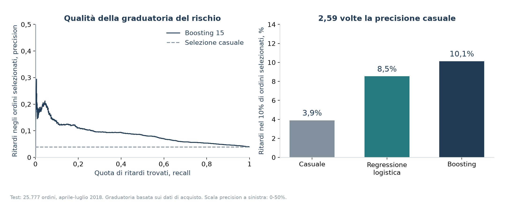

Il test ha 1.006 ritardi. Selezionare 2.578 ordini ne individua **261**, contro circa 101 attesi casualmente; **745** restano fuori dalla coda. Il precedente risultato di 2,87x diventa **2,59x** dopo la modifica delle variabili. Precisione e richiamo costanti sono valori attesi casuali perché tutti i punteggi sono uguali. Average Precision non è l’area trapezoidale PR. Un Brier inferiore è migliore; la calibrazione logistica è debole.

## Venditori e regioni selezionati prima del test

Seleziono dieci venditori per numero di ritardi precedenti ad aprile, con almeno 100 ordini a venditore singolo, e tre stati con almeno 200 ordini. Congelo le liste prima del test. Il volume conta: è un gruppo per verificare i processi, non una piccola coda ad alto rischio.

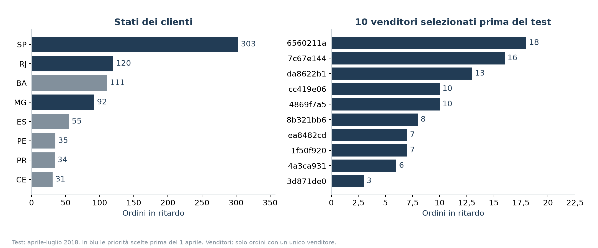

| ID venditore | Ordini nel test | Ordini in ritardo | Tasso di ritardo |
| --- | ---: | ---: | ---: |
| 6560211a19b47992c3666cc44a7e94c0 | 532 | 18 | 3,4% |
| 7c67e1448b00f6e969d365cea6b010ab | 188 | 16 | 8,5% |
| da8622b14eb17ae2831f4ac5b9dab84a | 342 | 13 | 3,8% |
| 4869f7a5dfa277a7dca6462dcf3b52b2 | 357 | 10 | 2,8% |
| cc419e0650a3c5ba77189a1882b7556a | 163 | 10 | 6,1% |
| 8b321bb669392f5163d04c59e235e066 | 295 | 8 | 2,7% |
| 1f50f920176fa81dab994f9023523100 | 260 | 7 | 2,7% |
| ea8482cd71df3c1969d7b9473ff13abc | 285 | 7 | 2,5% |
| 4a3ca9315b744ce9f8e9374361493884 | 288 | 6 | 2,1% |
| 3d871de0142ce09b7081e2b9d1733cb1 | 143 | 3 | 2,1% |

| Stato del cliente | Ordini nel test | Ritardi | Tasso di ritardo | Quota dei ritardi nel test |
| --- | ---: | ---: | ---: | ---: |
| SP | 11.583 | 303 | 2,6% | 30,1% |
| RJ | 3.025 | 120 | 4,0% | 11,9% |
| MG | 2.882 | 92 | 3,2% | 9,1% |

L’unione contiene **18.359 ordini e 565 ritardi**, contati una sola volta. I venditori coprono 98 ritardi e gli stati 515, con sovrapposizioni. Il tasso del gruppo è 3,1%, inferiore al 3,9% dell’intero test. BA emerge dopo con 111/894 ritardi (12,4%), ma non cambio la lista congelata usando gli esiti del test. [Tabella dei venditori](reports/sellers.csv) e [tabella degli stati](reports/regions.csv) includono volumi storici e contributi. Lo stato del cliente non attribuisce responsabilità a un corriere.

## Riacquisti e scenario finanziario

Collego gli ordini con **`customer_unique_id`**, non con `customer_id`, specifico dell’ordine. Prendo il primo ordine consegnato con voto di ogni acquirente e avvio l’osservazione dopo consegna e risposta: `anchor = max(consegna, risposta)`. Il riacquisto è un acquisto successivo consegnato, strettamente dopo l’ancora, entro 90 giorni e prima del 1 settembre 2018. Mantengo solo chi ha tutti i 90 giorni disponibili prima del limite. Acquisti durante l’attesa o precedenti alla risposta non contano come riacquisti successivi all’esperienza.

| Coorte con osservazione completa | Clienti | Riacquirenti | Tasso |
| --- | ---: | ---: | ---: |
| Tutti | 72.373 | 754 | 1,0% |
| Primo ordine puntuale | 67.261 | 714 | 1,1% |
| Primo ordine in ritardo | 5.112 | 40 | 0,8% |

Escludo 20.374 acquirenti con osservazione incompleta e 867 ordini successivi precedenti all’ancora dal conteggio dei riacquisti. La **differenza di 0,3 punti percentuali è descrittiva**, senza correzione causale. Il primo carrello ripetuto medio vale R$121,38. La coorte include solo consegne, omette riacquisti cancellati/non consegnati ed è soggetta a selezione alla fine dell’osservazione. [Coorte](reports/repeat_cohort.csv), [tassi per gruppo](reports/repeats_by_lateness.csv).

Il beneficio base dei riacquisti è **zero**. Se ipotizzo un aumento nella demo, conto ciascun acquirente una volta. Con probabilità indipendente di risoluzione `p` e `n` ordini in ritardo per acquirente, la probabilità di aiutarlo è `1 - (1-p)^n`. Il gruppo ha 564 acquirenti unici in ritardo per 565 ordini, cioè 282,25 acquirenti aiutati attesi con `p=50%`. L’indipendenza è un’ipotesi separata dal tasso osservato di riacquisto.

Confronto per ogni ordine supportato il voto previsto al ritardo effettivo con quello a ritardo zero, limitando entrambi a 1-5. Venditori/stati/categorie sconosciuti, ordini con più venditori e termini non stimabili ricevono incremento zero. Nel test intero ci sono 5.212 ordini non supportati dal modello complessivo e 5.393 da quello con creazione successiva. Divido per tutte le **25.605** recensioni del test:

```text
Modello complessivo: 844,86 stelle previste × 50% / 25.605 = +0,016
Creazione successiva: 337,31 × 50% / 25.605 = +0,007
```

Assumo partecipazione alle recensioni, prodotti, date promesse e tempi di recensione invariati. Applicare il modello successivo al questionario ad altri ordini è un’ipotesi di sensibilità. Il confronto non è un intervallo di confidenza; un intervento può modificare il momento della recensione.

| Ipotesi finanziaria | Valore base |
| --- | ---: |
| Ritardi risolti | 50% |
| Probabilità di contatto evitato; costo | 50%; R$8 |
| Probabilità di compensazione evitata; importo | 20%; R$20 |
| Aumento della probabilità di riacquisto | 0% |
| Carrello ripetuto opzionale; margine | R$140; 15% |
| Costo per ogni ordine selezionato | R$3 |

```text
Ritardi risolti = 565 × 50% = 282,5
Assistenza = 282,5 × 50% × R$8 = R$1.130
Compensazioni = 282,5 × 20% × R$20 = R$1.130
Margine riacquisti = 282,25 clienti unici × 0% × R$140 × 15% = R$0
Intervento = 18.359 ordini selezionati × R$3 = R$55.077
Netto = R$1.130 + R$1.130 + R$0 - R$55.077 = -R$52.817
Pareggio = R$2.260 / 18.359 = R$0,12 per ordine selezionato (arrotondato)
Con R$0,10/ordine: R$2.260 - R$1.835,90 = +R$424,10
```

Il costo si applica anche agli ordini puntuali. Contatti e compensazioni sono separati e possono sovrapporsi. Assumo che entrambi derivino dal ritardo e scompaiano risolvendolo; ometto costi fissi e contatti residui. Olist non contiene costi reali degli interventi, dell’assistenza o margini. Il carrello opzionale R$140 è un’ipotesi arrotondata, non il carrello ripetuto osservato. Gli importi sono reais brasiliani senza conversione o adeguamento all’inflazione.

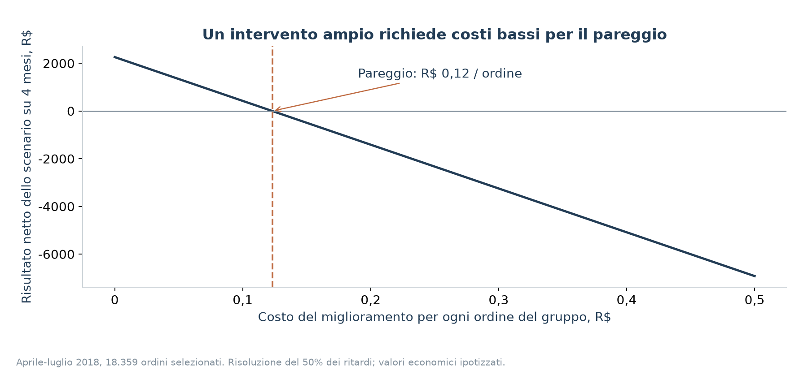

## File e test

`src/data.py` prepara ordini e storici; `src/risk.py` addestra i modelli; `src/analysis.py` stima voti e scenari; `src/diagnostics.py` misura tempi, testo mancante e coorti di riacquisto. `src/topics.py` gestisce i temi. `src/survey.py` aggiunge il confronto temporale separato; file e coefficienti dei modelli esistenti restano invariati. Script Python ordinari rigenerano CSV, JSON, dati preparati e immagini. I notebook bilingui in `notebooks/` mostrano calcoli eseguiti dell’audit. Installo `requirements-notebook.txt` per avviarli; gli identificatori tecnici delle fonti restano invariati.

Verifico confini e parità degli storici, invariabilità agli esiti futuri, ritardo di calendario, unicità degli ordini, disponibilità delle etichette, identità del cliente, finestre mature, tempi del questionario, testo vuoto, effetti fissi contro OLS con indicatori espliciti, esclusioni multi-venditore, controfattuali completi, termini non supportati, formule finanziarie e demo nelle due lingue. **24 test superati** dopo l’audit.

Conservo in Git codice, test, tabelle analitiche, notebook e immagini. `.gitignore` esclude CSV originali, Parquet preparati, modelli binari, vettori e credenziali locali. Downloader e manifest SHA-256 restano versionati. Dopo una nuova clonazione, scarico i dati ed eseguo i comandi di riproduzione prima di avviare la demo o i suoi test di integrazione. L’archivio locale include dati e binari per la riproduzione immediata; questi file non sono presenti nel repository pubblico.

## Limiti e prossimi passi

- Eseguirei un esperimento randomizzato con promesse stabili e costi misurati. Associazioni grezze, aggiustate o per tempi del questionario non identificano l’effetto causale della consegna sul voto.
- Aggiungerei eventi di corriere, imballaggio, resi e rotte prima di attribuire responsabilità. Una recensione condivisa non identifica il responsabile tra più venditori.
- Otterrei versioni del catalogo e delle promesse al checkout: la disponibilità degli snapshot è ipotizzata, non interamente dimostrata dall’estrazione.
- Modellerei separatamente ordini cancellati, non consegnati e censurati, estenderei l’osservazione dei riacquisti ed eviterei di tradurre la differenza descrittiva in profitto.
- Etichetterei più recensioni in modo indipendente, conserverei gruppi misti e studierei separatamente chi non lascia testo.
- Riaddestrerei su dati recenti, verificherei calibrazione per mese/stato/nuovo venditore e sceglierei la soglia operativa sui periodi precedenti. Il modello del 2018 richiede nuova validazione prima dell’uso attuale.
