# Olist Delivery Impact

**Poor reviews: delivery or product?**

**English** | [Italiano](README.it.md)

I analyzed 99,441 Olist orders to decide where an improvement budget could help: delivery processes, order completeness or product quality.

**Problem and business metric.** Delivered orders average **4.16/5**; 6.8% arrive late. Late orders average **2.27**, compared with **4.29** on time. Yet **67.6% of one- and two-star reviews concern on-time orders**. Delivery alone cannot explain poor ratings.

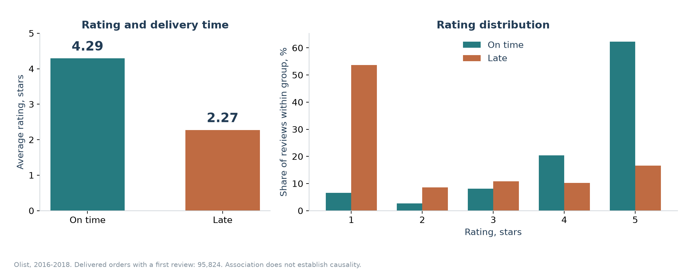

> **Three findings**
>
> 1. **Delay penalty:** -0.50 stars at the late threshold, plus -0.30/day in days 1-7. These are observational associations with seller fixed effects.
> 2. **Survey timing:** 81.6% of all late orders have a survey created before delivery. This is the invitation date; 68.5% have a response written before delivery.
> 3. **Repeat purchases:** about 1.0% of buyers repeat within 90 days. I find no demonstrated payback from faster delivery through repeat purchases. With zero repeat benefit, the base break-even budget is R$0.12/order.

**Recommendation.** I would send the survey after confirmed delivery, retain a separate complaint channel for undelivered orders, and use the 2.59x-lift ranking to trigger proactive notifications in the top-risk decile. I would validate both policies in a buyer-level A/B test with rating as the primary metric and complaints/cancellations as secondary metrics. [Test design](#recommendation-and-ab-test).

## Demo and reproduction

The five-tab Streamlit demo has English and Italian versions, filtered charts, text complaints, seller/state tables, a checkout form and an assumptions calculator. The local archive includes prepared results; I can start it with `streamlit run app.py` after installing dependencies.

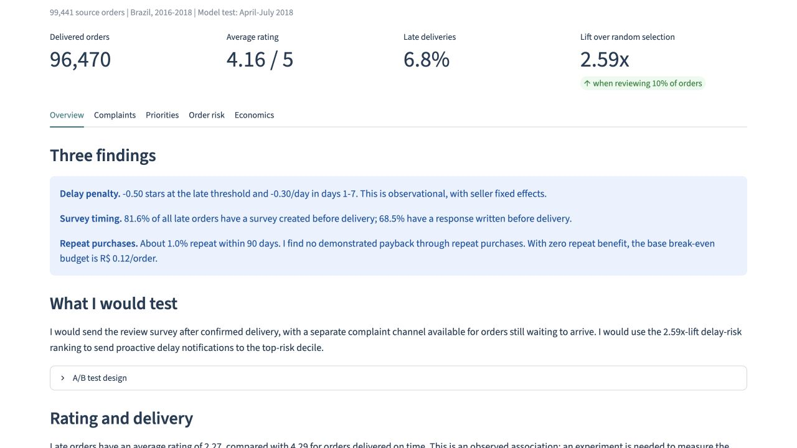

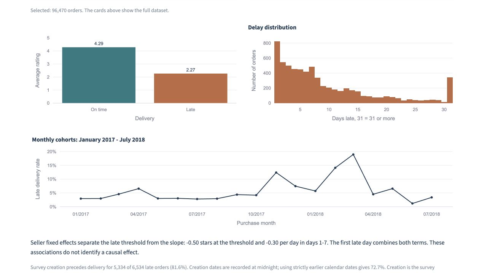

```bash
git clone https://github.com/Gr1gorii/olist-delivery-impact.git
cd olist-delivery-impact
python3.11 -m venv .venv
source .venv/bin/activate
pip install -r requirements.txt
python scripts/download_data.py
python scripts/run_analysis.py --topics
python scripts/analyze_survey_timing.py
python scripts/make_figures.py
python -m pytest -q
streamlit run app.py
```

I verified Python 3.11. The downloader obtains the six original CSV tables from Kaggle and checks the saved SHA-256 manifest. No credentials are stored. `--language it` selects Italian console messages. Without `--topics`, I recalculate all other results and retain existing topic outputs. The encoder revision is pinned; embeddings are cached. A clean Git checkout downloads the encoder on its first topic run. `OMP_NUM_THREADS=4 OPENBLAS_NUM_THREADS=4` limits CPU threads where needed. I can choose another demo port with `--server.port 8503`.

## Audit findings and fixes

I recorded findings before changing the implementation. I found no direct delivery or review outcome in the risk features. The original histories waited for delivery, but category history was missing and the purchase-time assumptions were incompletely documented. I added category history, boundary tests and a fresh temporal evaluation. I added measured repeat purchases using `customer_unique_id`; the old repeat uplift was an assumption, not an observed repeat rate. I changed its base value to zero.

I separated survey creation from response timing, added actual seller fixed effects and raw comparisons, quantified missing text, and made multi-seller attribution explicit. Seller-clustered standard errors in the previous regression did not amount to seller fixed effects. I also corrected the scenario reset so both the late indicator and delay days become zero. Tests now check the full threshold-plus-days counterfactual. Raw data and binaries are excluded from Git, and bilingual dataset-license files are included.

## Data, lateness and attribution

Source: [Brazilian E-Commerce Public Dataset by Olist](https://www.kaggle.com/datasets/olistbr/brazilian-ecommerce), 2016-2018, [CC BY-NC-SA 4.0](https://creativecommons.org/licenses/by-nc-sa/4.0/). Attribution and transformation details: [DATA_LICENSE.md](DATA_LICENSE.md).

| Population | Orders |
| --- | ---: |
| Source | 99,441 |
| Delivered with valid dates and items | 96,470 |
| With a scored first review | 95,824 |
| Late delivered orders | 6,534 |
| Multi-seller delivered orders | 1,275 |

I keep one row and one first review per order. The first review is the earliest response timestamp, then review ID to break ties. There are 551 extra review rows in the source. I define:

```text
delay_days = date(order_delivered_customer_date) - date(order_estimated_delivery_date)
late = delay_days > 0
```

Delivery at 23:59 on the promised day is on time. I exclude cancellations, undelivered orders, invalid dates and missing items. Risk is conditional on eventual delivery; cutoff dates also exclude unresolved deliveries.

A multi-seller order has one shared review; I never duplicate it across sellers. The primary seller for checkout features is the seller with the highest total merchandise value, with seller ID as tie-breaker. The category is from the highest-priced item, with product ID as tie-breaker. Seller rankings and seller fixed-effect regressions use **single-seller orders only**. Multi-seller orders stay in state and order-level summaries, receive zero modeled rating gain, and still incur cost if state-targeted. Primary seller assignment is a feature convention, not attribution of blame.

Portuguese source text and category identifiers remain intact. I show translated category labels and the same 50 audited examples in both languages; display translations do not enter clustering.

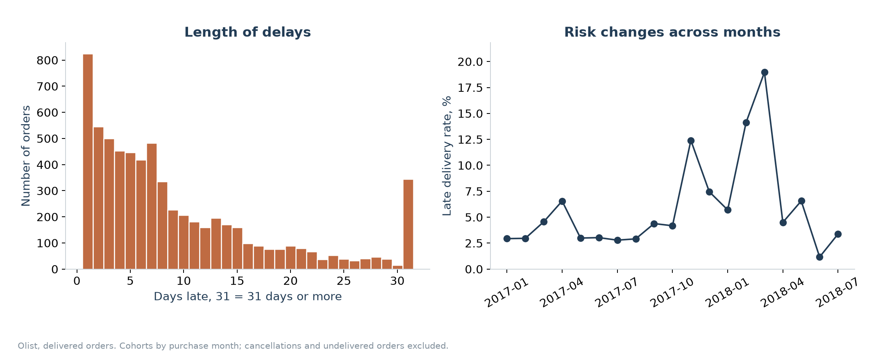

## Survey timing and rating impact

`review_creation_date` is the survey invitation creation date. `review_answer_timestamp` is the response. The [dataset description](https://www.kaggle.com/datasets/olistbr/brazilian-ecommerce) explains that invitations follow delivery or the due date. A pre-delivery invitation is therefore expected for many delayed orders.

| Before actual delivery | Numerator | Denominator | Share |
| --- | ---: | ---: | ---: |
| Creation timestamp, all late orders | 5,334 | 6,534 | 81.6% |
| Creation timestamp, scored late orders | 5,334 | 6,381 | 83.6% |
| Creation on a strictly earlier calendar day, all late | 4,753 | 6,534 | 72.7% |
| Response timestamp, all late | 4,476 | 6,534 | 68.5% |

Creation dates are stored at midnight; 581 same-day invitations account for the timestamp/calendar difference. Missing review times remain in the all-late denominator and are reported separately in [review_timing.csv](reports/review_timing.csv). I use the exact timestamp split requested and show its date-resolution sensitivity.

I fit OLS with **seller fixed effects**, customer state, category, month, `log(1 + price)`, `log(1 + freight)`, promised duration and item count. I absorb seller dummies with [AbsorbingLS](https://bashtage.github.io/linearmodels/iv/absorbing/linearmodels.iv.absorbing.AbsorbingLS.html) and cluster 95% intervals by seller. All fitting purchases, deliveries and responses precede 1 April 2018; multi-seller orders are excluded. Raw differences below use each model's identical sample, rather than different cohorts.

| Sample | Reviews | Raw late - on-time | Late threshold | Days 1-7, per day | First late day |
| --- | ---: | ---: | ---: | ---: | ---: |
| All eligible reviews | 58,743 | -2.03 | -0.50 | -0.30 | -0.80 |
| Survey created before delivery | 4,311 | -2.27 | -1.09 | -0.20 | -1.29 |
| Survey created after/equal delivery | 54,432 | -0.53 | -0.70 | 0.14 | -0.56 |
| Response after/equal delivery | 56,065 | -0.61 | -0.55 | 0.01 | -0.54 |

The pooled raw difference is **-2.03 stars**. The adjusted first late day is **-0.80**, with 95% interval **[-0.91, -0.69]**. It combines the threshold **-0.50** (95% interval [-0.64, -0.37]) with the first-week slope **-0.30/day** ([-0.32, -0.27]). An on-time/late jump is not the same quantity as a per-day association.

```text
Rating delay component = threshold × late
  + slope_1 × min(max(delay_days, 0), 7)
  + slope_2 × min(max(delay_days - 7, 0), 7)
  + slope_3 × min(max(delay_days - 14, 0), 16)
```

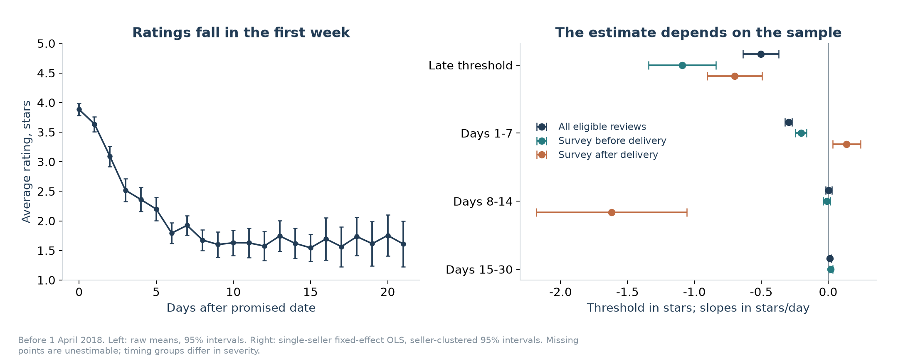

The creation-after-delivery first-week slope is +0.14/day, while the response-after-delivery slope is +0.01/day and its interval includes zero. These are selected groups, not evidence that delays improve ratings. Scored late orders in the creation-before group have mean delays of 12.26 days versus 1.64 after creation. Timing depends on eventual delay severity. The creation-after group has no estimable days-15-30 term; I save it as missing and give unsupported scenario orders zero gain. I do not extrapolate beyond the 30-day cap. Seller effects remove stable seller differences, but cannot remove every confounder or establish causality.

Full estimates: [pooled](reports/rating_coefficients.csv), [creation before](reports/rating_before_delivery.csv), [creation after](reports/rating_after_delivery.csv), [response after](reports/rating_after_response.csv), [matched raw comparisons](reports/rating_comparison.csv).

## The "not yet received" penalty

I compare late orders whose survey was created before delivery with those created after or at delivery, **at the same exact calendar-day delay and with seller fixed effects**. This is a separate observational diagnostic; I keep the existing risk and rating models unchanged. I use purchases, deliveries and responses known before 1 April 2018 and single-seller orders only.

The comparison contains **1,966 orders from 631 sellers**: 1,382 with creation before delivery and 584 after or at delivery. Both groups occur at delays of **1-6 or 8 days**. I exclude 1,507 late orders without delay-day overlap. Their eventual mean scores are **2.20 vs 3.76**, a raw gap of **-1.56 stars**. After absorbing seller and exact delay-day effects, the before-delivery creation gap is **-1.06 stars**, with seller-clustered 95% interval **[-1.31, -0.82]**.

```text
review_score = seller effect + exact delay-day effect + beta × before_delivery + residual
```

| Comparison | Orders | Sellers | Before - after, stars | 95% interval |
| --- | ---: | ---: | ---: | --- |
| Survey creation, timestamp | 1,966 | 631 | -1.06 | [-1.31; -0.82] |
| Survey creation, calendar-day sensitivity | 2,246 | 677 | -1.16 | [-1.45; -0.87] |
| Survey creation, same seller and delay day | 413 | 69 | -0.93 | [-1.24; -0.62] |
| Written response, timestamp | 2,928 | 775 | -1.96 | [-2.14; -1.78] |

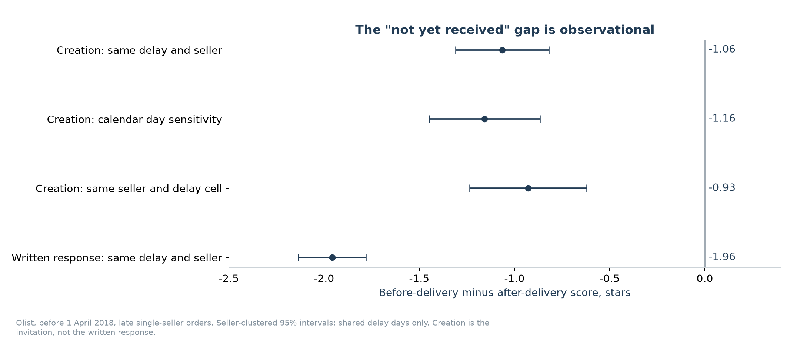

The stricter seller-by-delay-day comparison uses 413 orders from 69 sellers and gives **-0.93 stars**. The written-response comparison gives **-1.96 stars** in its own overlap sample; it measures response timing rather than the invitation. Creation at midnight is not proof that a customer had not received the parcel when writing the review. These estimates do not isolate the effect of sending an invitation later, do not generalize to delays without overlap and cannot be added to the existing delay coefficients or profit calculation.

[Full diagnostic table](reports/not_received_penalty.csv). I regenerate it with `python scripts/analyze_survey_timing.py`, which does not retrain or overwrite existing models.

## Recommendation and A/B test

I would send the review survey **only after confirmed delivery**, and keep a separate complaint channel available while an order is undelivered. I would use the existing **2.59x-lift** risk ranking to trigger proactive delay notifications for the **top-risk decile**, with a threshold frozen on an earlier cohort. Notification wording would explain the expected delay and next update. These changes address waiting and communication; the risk model does not establish that a notification improves ratings.

I would validate both policies in a **2 × 2 randomized test**:

| Survey timing | Communication | Arm |
| --- | --- | --- |
| Current process | Usual updates | Control |
| After confirmed delivery | Usual updates | Survey timing |
| Current process | Proactive notifications in top-risk decile | Notifications |
| After confirmed delivery | Proactive notifications in top-risk decile | Both |

**Randomization unit.** I would assign `customer_unique_id` at checkout, keep the assignment stable for repeat orders and use the buyer's first eligible order as the index order. I would stratify by checkout risk decile and customer state. The complaint channel would be accessible in every arm, so changing survey timing does not remove access for non-receipt complaints.

**Primary metric.** I would compare mean first-review rating collected by **60 days after the original estimated delivery date**, using the same observation horizon in every arm. I would estimate the two assigned treatment effects and their interaction; the notification comparison would also be reported in the preselected top-risk decile. The primary rating is a mean among responders, so I would report review response and confirmed-delivery coverage alongside it. A higher mean caused by fewer unhappy respondents would not establish better service.

**Secondary metrics.** I would measure complaint contacts per 100 randomized index orders and cancellation rate over that same horizon, including orders never delivered. I would report notification and support costs. I would keep promised dates fixed, size the test from historical rating variance, response rate and a prespecified minimum useful effect, and set complaint/cancellation guardrails before launch. I would analyze assigned groups with confidence intervals and wait for full follow-up before a rollout decision.

## Text coverage and complaint topics

**55,224/95,824 scored reviews (57.6%) have no nonblank title or message.** Their mean score is 4.41, versus 3.81 for 40,600 text reviews. Topics describe only reviews with text and cannot describe the whole review population.

| Score | Without text, count (% within group) | With text, count (% within group) |
| --- | ---: | ---: |
| 1 | 2,028 (3.7%) | 7,313 (18.0%) |
| 2 | 921 (1.7%) | 2,000 (4.9%) |
| 3 | 4,389 (8.0%) | 3,514 (8.7%) |
| 4 | 12,707 (23.0%) | 6,192 (15.2%) |
| 5 | 35,179 (63.7%) | 21,581 (53.2%) |

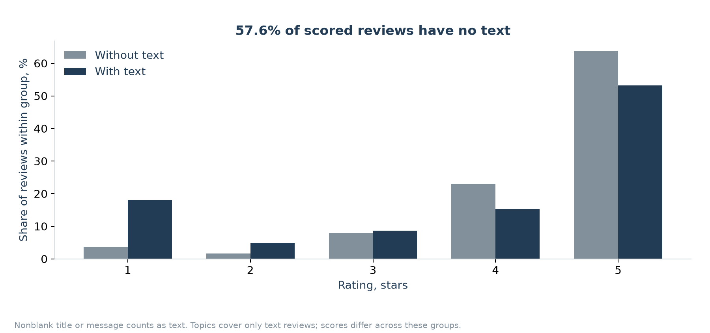

I cluster **9,108 reviews rated 1-2 with at least 15 characters**, using normalized [multilingual-e5-small](https://huggingface.co/intfloat/multilingual-e5-small) embeddings with the `query:` prefix and KMeans with ten clusters. I fit on 5,776 reviews known before 1 April 2018 and assign later reviews to the saved centers. Names come from pre-test keywords and examples. The app shows translations of five random training examples per cluster, with originals available.

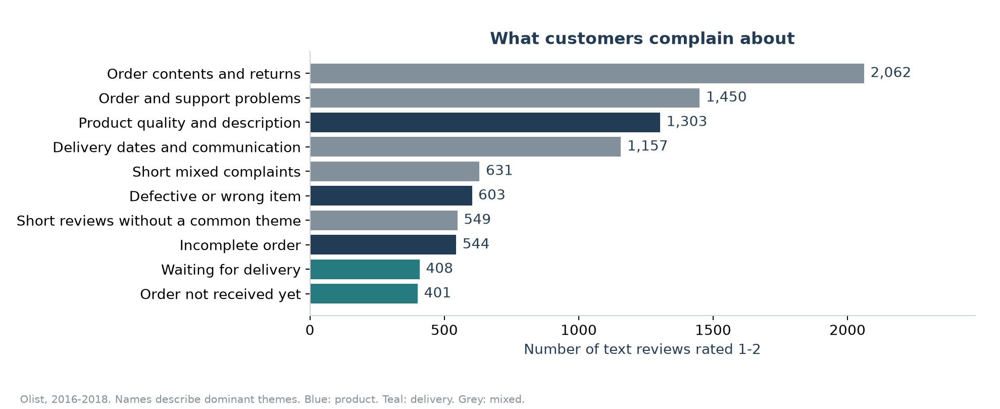

Separation is weak (training silhouette 0.020), and 58.7% of test text complaints remain in mixed groups. In the small random audit, 14/15 examples in three product-oriented groups concerned products or order contents; only 6/10 in the waiting groups concerned logistics. These counts are not corpus-wide accuracy. Damage or missing items cannot establish which stage caused the problem. Tables: [text coverage](reports/text_coverage.csv), [score distribution](reports/score_by_text.csv), [topic audit](reports/topic_audit.csv).

## Every checkout risk feature

| Feature | Purchase-time source | Availability |
| --- | --- | --- |
| `log_price` | log(1 + basket merchandise value) | Checkout basket/address/time |
| `freight_share` | Quoted freight / max(basket value, 1) | Checkout basket/address/time |
| `item_count` | Items in the basket | Checkout basket/address/time |
| `seller_count` | Distinct sellers in the basket | Checkout basket/address/time |
| `weight` | Sum of catalog item weights | Checkout snapshot assumed |
| `promised_days` | Estimated delivery date minus purchase date, calendar days | Checkout snapshot assumed |
| `purchase_month` | Month of purchase timestamp | Checkout basket/address/time |
| `purchase_weekday` | Weekday of purchase timestamp | Checkout basket/address/time |
| `purchase_hour` | Hour of purchase timestamp | Checkout basket/address/time |
| `same_state` | Primary seller state equals customer state | Checkout snapshot assumed |
| `seller_past_count` | Earlier observable deliveries for the primary seller | Prior purchases and deliveries only |
| `seller_past_late` | Smoothed late rate for those deliveries | Prior purchases and deliveries only |
| `region_past_count` | Earlier observable deliveries to the customer state | Prior purchases and deliveries only |
| `region_past_late` | Smoothed late rate for those deliveries | Prior purchases and deliveries only |
| `category_past_count` | Earlier observable deliveries in the primary category | Prior purchases and deliveries only |
| `category_past_late` | Smoothed late rate for those deliveries | Prior purchases and deliveries only |
| `customer_state` | Customer address at checkout | Checkout basket/address/time |
| `seller_state` | Primary seller registered state | Checkout snapshot assumed |
| `category` | Category of the highest-priced item | Checkout snapshot assumed |

These 19 features are intended to be known at purchase time. Price, freight and basket contents represent the checkout transaction. Catalog weights/categories, seller location and the promised date are **snapshot assumptions**: Olist has no historical versions, so I cannot empirically prove that the extract matches the purchase-time snapshot. The same limitation propagates to category history. I do not use scores, review text, actual delivery, status, approval time or carrier deadlines as predictor columns.

For a current purchase at time `t`, every historical contributor satisfies **purchase < t and delivery < t**, strictly. The window expands without a rolling cutoff. Pending earlier purchases cannot contribute an eventual outcome; equal-time purchases or deliveries cannot contribute. Invalid delivery-before-purchase events are excluded. Rates are `(earlier observable late orders + 1) / (earlier observable deliveries + 20)`, with 5% prior for an unseen group. Seller history follows the primary-seller convention. Preprocessing is fitted on training data only. The demo scores a checkout snapshot at 1 April 2018 using that same history rule.

## Temporal validation, rerun after audit

| Stage | Purchases | Delivery label available | Orders |
| --- | --- | --- | ---: |
| Train | Before 1 January 2018 | Before 1 January 2018 | 41,197 |
| Validation | January-March 2018 | Before 1 April 2018 | 16,782 |
| Refit | Before 1 April 2018 | Before 1 April 2018 | 60,468 |
| Test | April-July 2018 | Before 1 September 2018 | 25,777 |

Refit also recovers older purchases whose outcomes became available later. Review responses on or after 1 September do not enter test rating outcomes. I choose the 15-leaf boosting model by validation Average Precision (0.140), then evaluate the fixed choice on test. Baselines are constant probability and logistic regression. The rerun includes the added category history.

| Model | Average Precision | ROC AUC | Brier | Precision @10% | Recall @10% |
| --- | ---: | ---: | ---: | ---: | ---: |
| Constant | 0.039 | 0.500 | 0.0379 | 3.9% | 10.0% |
| Logistic regression | 0.070 | 0.668 | 0.0506 | 8.5% | 21.9% |
| Boosting 15 | 0.087 | 0.685 | 0.0371 | 10.1% | 25.9% |

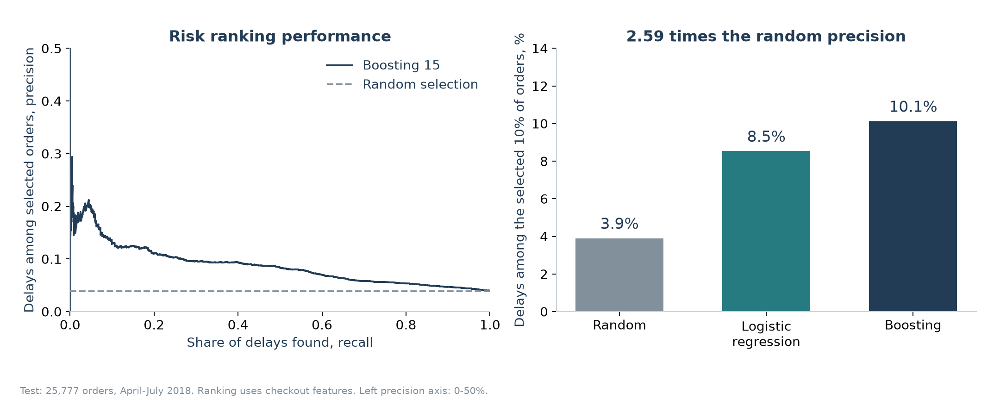

The test has 1,006 delays. Selecting 2,578 orders finds **261**, while random selection finds about 101 in expectation; **745** remain outside the queue. The previous 2.87x result becomes **2.59x** after this feature change. Constant precision/recall are random-selection expectations because scores tie. Average Precision is not trapezoidal PR AUC. Lower Brier is better; logistic calibration is weak.

## Frozen sellers and regions

I select ten sellers by pre-April delay count, with at least 100 single-seller orders, and three states with at least 200 orders. I freeze the lists before test. Volume matters: this identifies a process-audit group rather than a small high-risk queue.

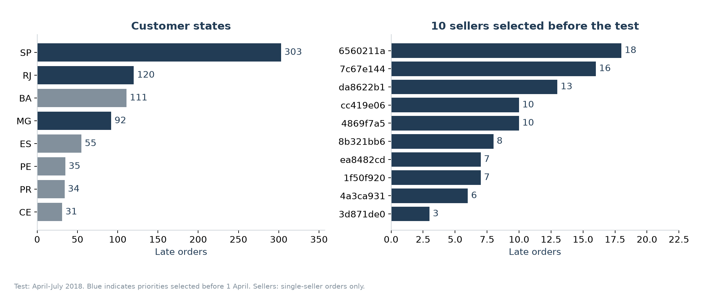

| Seller ID | Test orders | Late orders | Late rate |
| --- | ---: | ---: | ---: |
| 6560211a19b47992c3666cc44a7e94c0 | 532 | 18 | 3.4% |
| 7c67e1448b00f6e969d365cea6b010ab | 188 | 16 | 8.5% |
| da8622b14eb17ae2831f4ac5b9dab84a | 342 | 13 | 3.8% |
| 4869f7a5dfa277a7dca6462dcf3b52b2 | 357 | 10 | 2.8% |
| cc419e0650a3c5ba77189a1882b7556a | 163 | 10 | 6.1% |
| 8b321bb669392f5163d04c59e235e066 | 295 | 8 | 2.7% |
| 1f50f920176fa81dab994f9023523100 | 260 | 7 | 2.7% |
| ea8482cd71df3c1969d7b9473ff13abc | 285 | 7 | 2.5% |
| 4a3ca9315b744ce9f8e9374361493884 | 288 | 6 | 2.1% |
| 3d871de0142ce09b7081e2b9d1733cb1 | 143 | 3 | 2.1% |

| Customer state | Test orders | Delays | Late rate | Share of all test delays |
| --- | ---: | ---: | ---: | ---: |
| SP | 11,583 | 303 | 2.6% | 30.1% |
| RJ | 3,025 | 120 | 4.0% | 11.9% |
| MG | 2,882 | 92 | 3.2% | 9.1% |

The union is **18,359 orders, 565 delays**, counted once. Sellers cover 98 delays; states cover 515, with overlap. Its 3.1% delay rate is below the overall test 3.9%. BA appears later with 111/894 delays (12.4%), but I do not change the frozen list using test outcomes. [Full seller table](reports/sellers.csv) and [state table](reports/regions.csv) include historical volume and contributions. A customer's state is not an assignment of responsibility to a carrier.

## Repeat purchases and the financial scenario

I join orders with **`customer_unique_id`**, not the order-specific `customer_id`. I take each buyer's first delivered, scored order and start follow-up after both delivery and review response: `anchor = max(delivery, response)`. A repeat is a subsequent delivered purchase strictly after this anchor, within 90 days and before 1 September 2018. I retain buyers only when the full 90 days fit before that cutoff. Purchases made while still waiting or before the response do not count as a post-experience repeat.

| Complete-follow-up cohort | Customers | Repeat buyers | Repeat rate |
| --- | ---: | ---: | ---: |
| All | 72,373 | 754 | 1.0% |
| First order on time | 67,261 | 714 | 1.1% |
| First order late | 5,112 | 40 | 0.8% |

I exclude 20,374 buyers with incomplete follow-up and 867 pre-anchor subsequent orders from repeat counting. The **0.3 percentage-point gap is descriptive**, with no causal correction. The average first repeat basket is R$121.38. This delivered-only cohort omits canceled and undelivered repeats and is subject to end-of-observation selection. [Buyer cohort](reports/repeat_cohort.csv), [group rates](reports/repeats_by_lateness.csv).

The base repeat benefit is **zero**. If I assume a nonzero uplift in the demo, each buyer counts once. With independent delay-resolution probability `p` and `n` delayed orders for a buyer, the probability of helping that buyer is `1 - (1-p)^n`. The selected group has 564 unique delayed buyers across 565 late orders, giving 282.25 expected helped buyers at `p=50%`. This independence assumption is separate from the observed repeat rate.

I compare each supported test order's fitted actual-delay score against a zero-delay score, clipping both to 1-5. Unseen seller/state/category combinations, multi-seller orders and unestimable delay terms receive zero gain. There are 5,212 unsupported pooled orders and 5,393 for the creation-after model, across the entire test. I divide by all **25,605** test reviews:

```text
Pooled fit: 844.86 predicted stars × 50% / 25,605 = +0.016
Creation-after fit: 337.31 × 50% / 25,605 = +0.007
```

This comparison assumes unchanged review participation, products, promised dates and review timing. Applying a post-survey fit to other orders is a sensitivity assumption. It is not a confidence interval; review timing may itself change under an intervention.

| Financial assumption | Base value |
| --- | ---: |
| Resolve delays | 50% |
| Avoided contact probability; cost | 50%; R$8 |
| Avoided compensation probability; amount | 20%; R$20 |
| Additional repeat-purchase probability | 0% |
| Optional repeat basket; margin | R$140; 15% |
| Intervention cost per selected order | R$3 |

```text
Resolved delays = 565 × 50% = 282.5
Support = 282.5 × 50% × R$8 = R$1,130
Compensation = 282.5 × 20% × R$20 = R$1,130
Repeat margin = 282.25 unique buyers × 0% × R$140 × 15% = R$0
Implementation = 18,359 selected orders × R$3 = R$55,077
Net = R$1,130 + R$1,130 + R$0 - R$55,077 = -R$52,817
Break-even = R$2,260 / 18,359 = R$0.12 per selected order (rounded)
At R$0.10/order: R$2,260 - R$1,835.90 = +R$424.10
```

All selected orders incur cost, including on-time orders. Contacts and compensation are separate and may overlap. I assume both are delay-caused and disappear when the delay is resolved; I omit fixed costs and remaining contacts. Olist contains no actual intervention costs, support costs or margins. The optional R$140 basket is a rounded assumption, not the observed repeat basket. Amounts are Brazilian reais with no inflation or currency conversion.

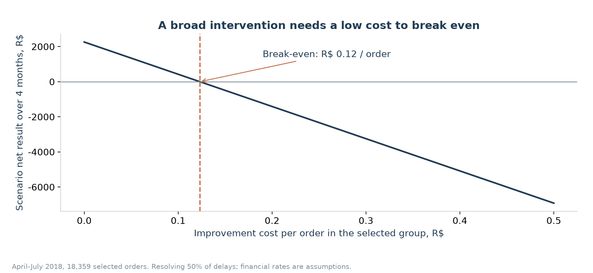

## Files and tests

`src/data.py` prepares orders and histories; `src/risk.py` trains the risk models; `src/analysis.py` estimates ratings and scenarios; `src/diagnostics.py` measures timing, missing text and repeat cohorts. `src/topics.py` handles complaint groups. `src/survey.py` adds the separate timing diagnostic; the existing model files and coefficients remain unchanged. Ordinary Python scripts regenerate CSVs, JSON, prepared data and figures. The bilingual notebooks in `notebooks/` show executed audit calculations. Install `requirements-notebook.txt` to run them; technical source identifiers stay unchanged.

I test strict history cutoffs and ties, future-outcome invariance, calendar lateness, unique order grain, training-label availability, unique buyer identity, mature repeat windows, survey timing, whitespace text, seller fixed effects against explicit-dummy OLS, multi-seller exclusions, full zero-delay counterfactuals, unsupported terms, financial formulas and both demo languages. **24 tests pass** after the audit.

I keep source code, tests, analytical tables, notebooks and figures in Git. `.gitignore` excludes raw CSV data, prepared Parquet, model binaries, embedding arrays and local credentials. The downloader and SHA-256 manifest remain versioned. In a fresh clone, I download the data and run the reproduction commands above before starting the demo or running its integration tests. The local archive includes data and binaries for immediate reproduction; these files are absent from the public repository.

## Limitations and what I would do next

- I would run a randomized pilot with stable promises and measured costs. Raw, controlled and timing-specific associations cannot identify delivery's causal rating effect.
- I would add carrier handover, packaging, returns and route events before assigning responsibility. A shared order review cannot identify a multi-seller culprit.
- I would obtain purchase-time catalog and promise versions. Checkout availability is assumed for snapshot fields, not fully established by this extract.
- I would model canceled, undelivered and censored orders separately, extend repeat follow-up and avoid interpreting the observed buyer-rate gap as profit.
- I would label more text reviews independently, retain mixed topics and study non-text reviewers separately.
- I would retrain on recent data, check calibration by month/state/new seller and choose a live queue threshold on previous periods. This model uses 2018 data and cannot be deployed as a current risk score without new validation.
